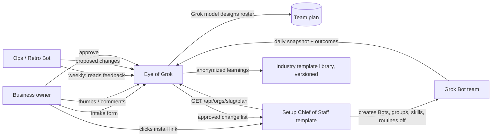

# Quick-start harness: a self-improving Grok Bot team for any business

Status: plan + research, 2026-10-19. Read [OVERVIEW.md](../OVERVIEW.md) first.

## The pitch

A small business (example: a small insurance agency) installs Grok Bot and gets a working Bot team in one click. Eye of Grok becomes the **control tower**: it designs the team from a short intake, ships it as Grok Bot templates, shows the live org, collects feedback, and proposes improvements that the owner approves.

Hackathon fit:

- **Track 2, bot economy.** This is a control plane for a bot team. A Setup Bot that has never seen the product reads the plan endpoint and builds the team with no human in the loop.
- **Track 3, one-person company.** The insurance-agency roster (intake, renewals, certificates, quote prep, ops) comes with approval rules for what goes back to the owner.

## Research findings

### Official surface (docs.x.ai/grok-bot, x.ai/bot/guides)

**Bots**
- Each Bot has a name, title, description, avatar, its own memory and its own chat.
- Durable rules live in the description.
- Duplicate copies the profile, skills and routines, but not memory.
- Hide does not pause a Bot: hidden Bots keep running their routines.
- Delete removes the profile, chat and routines. Files and logins on the computer remain.

**Groups**
- 2–6 Bots per group. The client caps it at 3 Bots when humans are in the group, and at 20 people.
- Approvals and secret requests appear only in 1:1 chats.

**Skills and routines**
- Skills are one account-wide library.
- Routines run on cron, Slack, GitHub, email, webhook and other events.
- Routines run at least 5 minutes apart, up to 50 per Bot. They auto-pause after a long user absence.

**Shared computer**
- One cloud computer per account, running in Cursor's cloud, US only.
- Every Bot can use every login on it.

**Templates are the official install path**
- Publish from Settings → Share as Template. Your setup's own template page is at `x.ai/bot/agent/<id>`.
- Deep link: `grokbot://app/v1/bot-template?id=<id>`, or `https://cursor.com/grok-bot/link/v1/bot-template?id=<id>`.
- Included: instructions, relevant memories, skills, routines, first-party plugins.
- Excluded: secrets, custom code, non-standard MCP servers, personal memories.
- Templates are versioned and can be shared publicly or with a team only.

**Team Bots and plans**
- A Team Bot is one Bot shared by many people. It holds up to 25 encrypted secrets and has roles (owner, manager, teammate).
- Grok Bot is included in X Premium ($30), Super ($100) and Ultra ($200), with team seats at the same prices.
- Team plans add SSO, role-based access, analytics and Team Rules.
- Enterprise adds SCIM, an MCP allowlist, enforced Auto-review, action logs and conversation export.

**No public API for creating Bots or reading the roster.** The Cursor Admin API covers org settings only.

### What the desktop app does (v0.71.2, read-only inspection)

**Template recipe JSON:**

```
{ profile:{name,description,avatarColor?,avatarShape?},
  memory:[{kind?,content}], skills:[{name,description,content}],
  routines:[{name,slug,description,content}], plugins:[{name,pluginId}],
  gettingStarted?:{skill} }
```

**How a template is applied.** On import, the app creates the Bot and sends it a setup message. The **Bot installs its own routines, plugins and memories.** This is why a Setup Bot can bootstrap a whole team.

**Undocumented backend.** The app calls a private Connect-RPC service, `GrokBotService` on api2.cursor.sh. It includes create/list Bots, rooms, skills, templates and transcripts. We do **not** build on it: it is undocumented and needs the customer's Cursor token.

**Starter catalog.** The app already ships about 45 role ideas, among them chief-of-staff-readout, executive-assistant, inbox-manager and pipeline-analyst. Of first-party templates, only SWE ships today.

### Community prior art

- [cobusgreyling/grok-bot-templates](https://github.com/cobusgreyling/grok-bot-templates): 49 templates, 10 teams, a "Bot Ready" score, autonomy levels L0–L3.
- [fakkelbot](https://github.com/dfakkeldy/fakkelbot): a Setup Bot builds the team. Bots self-improve through pull requests: low-risk ones auto-merge, and anything that adds powers needs a human.
- xAI's engineering guide: an ops Bot writes postmortems, keeps a shared playbook, runs nightly audits, and widens autonomy gradually.
- Nothing insurance-specific exists, official or community.

## Architecture



## Build steps

1. **Intake** (`/start`): the owner enters industry, team size, tools, pain points and hard rules. A Grok model, or a heuristic when there is no key, turns the intake into a proposed roster. The roster is drawn on the existing map.
2. **Plan endpoint**: `GET /api/orgs/<slug>/plan` returns the full team plan: each Bot's description and rules, skills, routines (disabled), groups and approval rules. Reads use a per-org token.
3. **Setup Chief of Staff template**: one public template whose getting-started skill fetches the plan and builds the team. It then pushes the first snapshot.
4. **Feedback**: `POST /api/orgs/<slug>/feedback` plus an MCP tool `record_feedback`. The owner leaves thumbs and comments per Bot in the map. Bots log outcomes, success or failure, through the same tool.
5. **Retro loop**: a weekly routine on the Ops Bot reads the feedback and proposes changes: edit a skill, add or merge a Bot, change a permission. The owner approves changes in Eye of Grok, then the Chief of Staff applies them. **Any change that adds powers always needs a human.**
6. **Template library**: anonymized learnings from all customers flow into new versions of the industry templates.

## Insurance agency starter team

| Bot | Job | Autonomy |
| --- | --- | --- |
| Chief of Staff | Front door, routing, morning brief, applies approved changes | L1 |
| Intake & Inbox | Triage email and web leads, gather client info, log to the agency management system | Drafts only |
| Renewals & Follow-ups | 60/30/10-day renewal reminders, missing-document chases | Drafts only |
| COI Desk | Certificate-of-insurance requests from the agency management system | Drafts; ask first before sending |
| Quote Prep | Gather quote info, prep carrier portal submissions | Never binds; never advises on coverage |
| Ops & Compliance | Weekly retro, playbook, audit of what Bots sent, client-data hygiene | L1 |

**Groups**
- **Client Desk**: Intake, Renewals, COI.
- **Leadership**: Chief of Staff, Ops.

**Hard rules**
- Client messages are drafts; a licensed human sends them.
- Never put SSNs, driver's licence numbers, health or claims data into group chats or templates.
- Ask first before any email, payment or binding.
- Use read-only service accounts for the agency management system.

**Compliance**
- GLBA and the state Insurance Data Security laws (NAIC #668) cover agencies.
- A Bot cannot act as a licensed producer.
- Grok Bot computers are US-hosted only.
- Bot deletion does not wipe the computer.
- Action logs are Enterprise-only, so log outcomes to Eye of Grok.

## Fix before real customers

- Ingest auth is one shared token, defaulting to `hackathon-demo`, and `/api/share/:orgId` returns it. Move to per-org tokens.
- Logan-specific prompts and fixtures (`CASEY_LOCAL_PROMPT`, `my-setup.ts`) and the localhost:3002 assumption are hardcoded.
- The data model has no fields for a Bot's instructions or routines, and there is no feedback table and no migrations.
